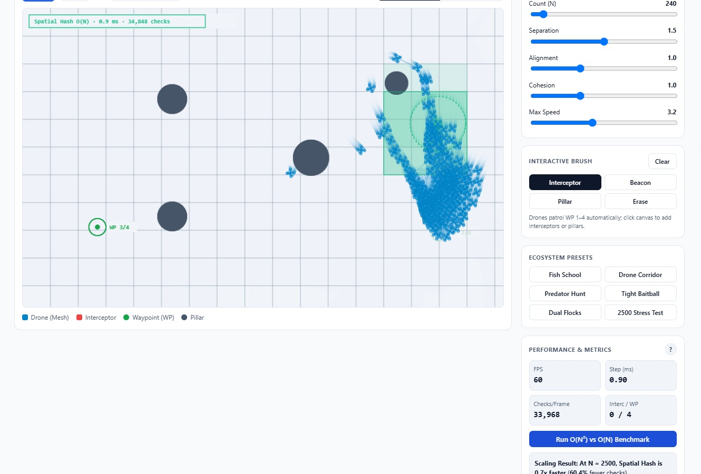

# eco-boids

Zero-dependency interactive Boids ecosystem and `O(N²)` vs `Spatial Hash Grid O(N)` performance benchmark. Runs directly in any browser (`index.html`), with `EN / 繁中` bilingual UI and Light/Dark themes.



## Features

- **Boids Swarm & Ecosystem (`js/simulation.js`)**:
  - Real-time **Separation**, **Alignment**, and **Cohesion** steering with live parameter sliders (`Count N` up to `3000`, weights, and `Max Speed`).
  - Interactive **Predators** (chase boids & trigger scatter), **Food** pellets (attract & deplete), and **Obstacles** (smooth avoidance).
  - 6 presets: `Fish School`, `Drone Corridor`, `Predator Hunt`, `Tight Baitball`, `Dual Flocks`, and `2500 Stress Test`.
- **4 Visual Presentation Styles (`js/renderer.js`)**:
  - Switch live between **Fish School**, **Drone Swarm** (quadrotors + Mesh neighbor links), **Crowd Flow** (pedestrian congestion colors), and **Velocity Heatmap**.
- **Spatial Hash Grid Benchmark (`js/spatial-hash.js`)**:
  - Toggle live between **Spatial Hash `O(N)`** and **Brute-Force `O(N²)`**, or click **Run O(N²) vs O(N) Benchmark** to measure exact speedup (`Xx faster`) and `% fewer checks`.
- **Purpose & Algorithm Tab (`js/app.js`)**:
  - Explains real-world applications (Game AI, Drone Swarms, Physics Engines) and why spatial hashing eliminates `O(N²)` bottlenecks.

## Usage

Open `index.html` in a modern browser, or run the Node.js verification suite:

```bash
node scripts/test.js
```
